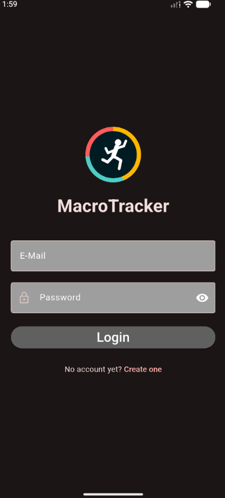
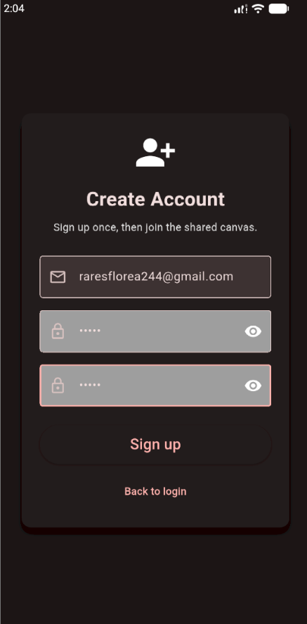
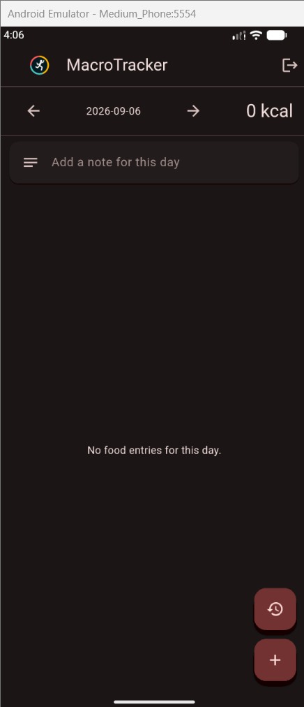
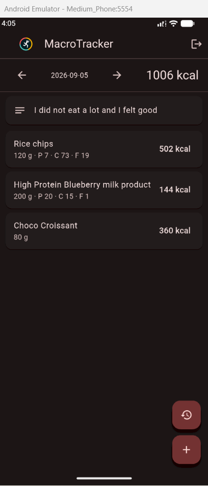
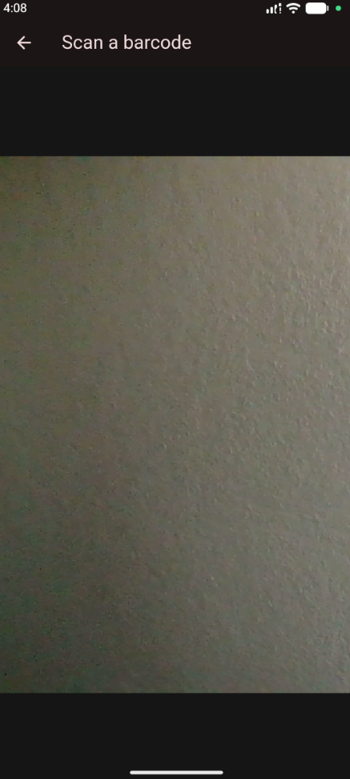
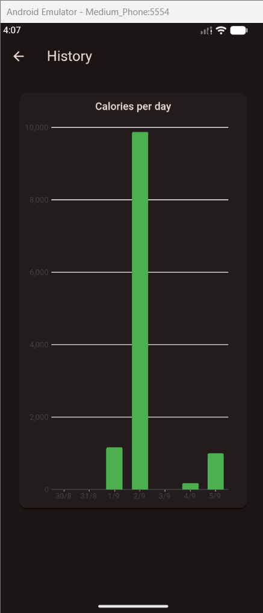

# MacroTracker

MacroTracker is a calorie tracking app done in Flutter, destined for people that want to pay more attention to what they eat and track their progress.

I created this app because I used to use one in the past(MyFitnessPal), but now you have to pay to use the barcode scanner feature, which in my eyes was the best feature, and so, after a few years of experience in coding I figured I can create something like this on my own.

## App Demo

A demo of the app can be found at the link: https://youtu.be/tI7GyZQkGlE 

## App Description

### LOGIN PAGE

Upon entering the app you will get sent to the log in page, where you either log in with your account if you have one or create a new one.

Throughout the project I am using Supabase for all the database wor, here im just doing the log in with a simple signInWithEmail function offered by Supabase

### SIGN UP PAGE

This is the page where you would be sent if you want to create a new account, having 3 text fields, validation and proper messages in case of error!

Here I'm using the signUpNewUser function offered by Supabase, but just after I'm doing the validation of the input fields, and in case of succes an email of confirmation will be sent on the inputed email adress.

### MAIN PAGE

This is he main page of the app, where the food that has been added in prevoius entries is being shown for the date speciefied at the top, or a message stating that no food was added for that specific day. A note for each day is being shown as well to express how the user felt in that day after eating the food. The option of changing the date to navigate through previous days of food logging is available and next to it you can see the total calories consumed in that day.

The two floating buttons in bootom right send you to 2 different pages, the first one send you to history and the second one to the actual barcode scanning and food logging!

The data fetching is done using the supabase functions and the food lookup is made by doing a get http call to 'https://world.openfoodfacts.org/api/v2/product/$barcode.json'.

### SCANNER PAGE

This is a simpler page where you just get the camera where you are supposed to scan a bardcode, after you do that you will get redirected to the main page where if the barcode was found you are asked to introduce the amount consumed or if it was not found you are asked to introduce the item itself and the quantity consumed afterwords.

Using MobileScanner to scan and identify barcodes.

### HISTORY PAGE

Here you get a history of the past 7 days of your caloric intake, to be aware of how it evolved over the past days.

## Data model
 
The `entries` table:
 
| Column | Type | Notes |
|---|---|---|
| `user_id` | uuid | Foreign key to the authenticated user |
| `name` | text | Product name |
| `kcal` | numeric | Scaled to the amount consumed |
| `protein` | numeric | Optional |
| `carbs` | numeric | Optional |
| `fats` | numeric | Optional |
| `grams` | numeric | Amount consumed |
| `date_added` | date | Used for daily grouping |